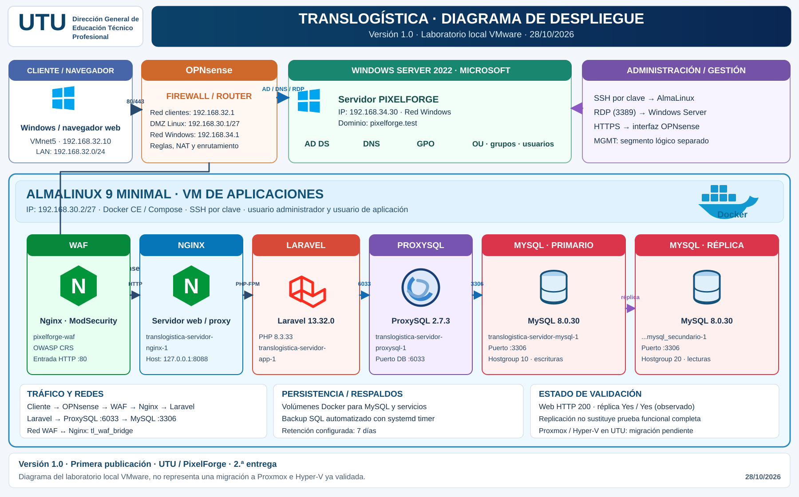

# Diagrama de Despliegue de Translogística — versión 1.0

**Fecha:** 28/10/2026  
**Entrega:** Segunda entrega · UTU  
**Alcance:** infraestructura de laboratorio local VMware.

Este diagrama identifica las capas de red y servicios: cliente, OPNsense, Windows Server 2022 con AD DS/DNS/GPO, AlmaLinux 9, Docker, WAF Nginx/ModSecurity, Nginx de aplicación, Laravel/PHP, ProxySQL 2.7.3, MySQL 8.0.30 primario y réplica, persistencia y respaldos.

La conexión Laravel → ProxySQL usa el puerto **6033**; ProxySQL → MySQL utiliza **3306**. La réplica observada presentó `Replica_IO_Running=Yes`, `Replica_SQL_Running=Yes` y retardo puntual de 0 segundos. Estas evidencias no sustituyen las pruebas funcionales integrales.

**Nota de alcance:** la migración de Linux a Proxmox y de Windows Server a Hyper-V en la infraestructura UTU sigue pendiente de validación. Las IP identificadas pertenecen al laboratorio.

La fuente publicada es **SVG vectorial**, apta para ampliar e insertar en documentación sin pérdida de resolución. Es una reconstrucción editable del despliegue; no es el mismo archivo binario PNG/PDF generado en el chat.
